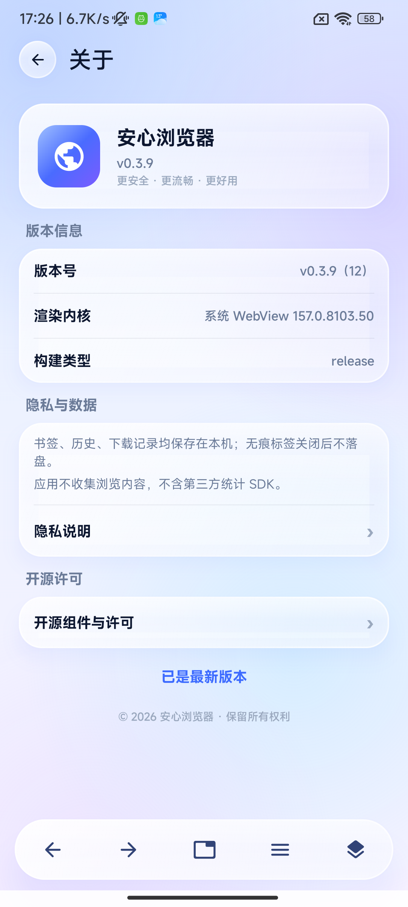
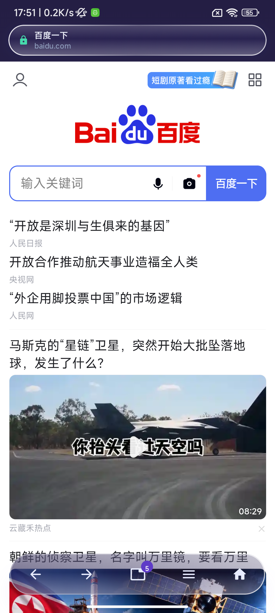
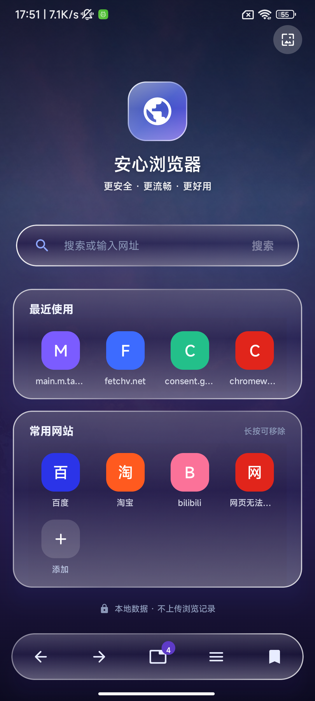
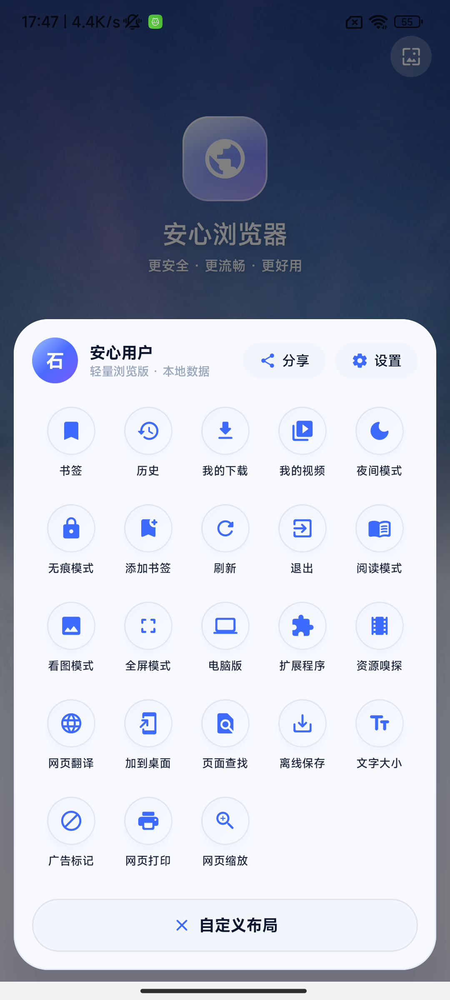
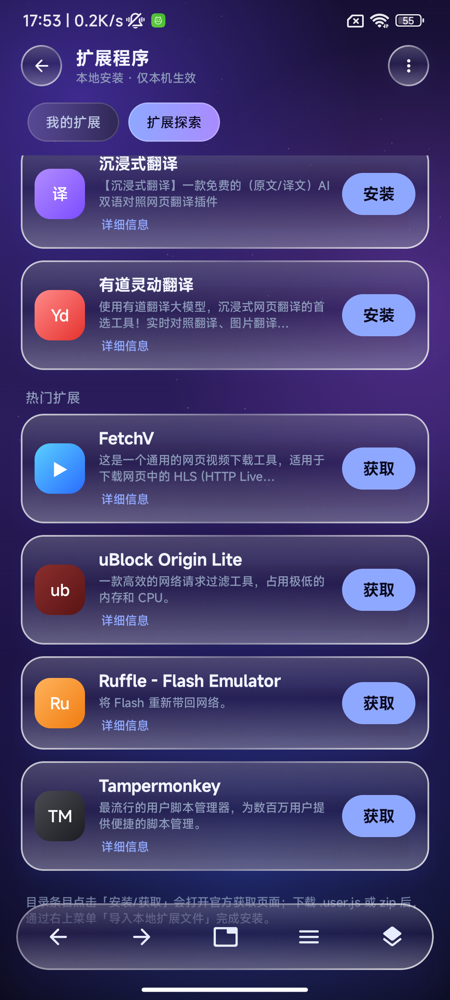
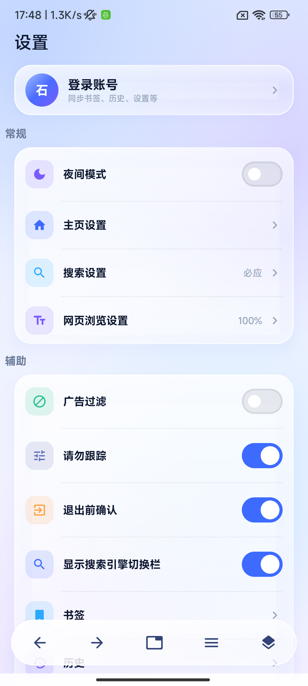

<div align="center">


# 安心浏览器

**更安全 · 更流畅 · 更好用 的 Android 浏览器**

基于 Jetpack Compose 打造，本地优先、不收集浏览数据，内置油猴脚本扩展引擎

[](https://github.com/ysthink/anxin-browser/releases/latest)
[](https://github.com/ysthink/anxin-browser/releases)
[](LICENSE)
[](../../actions)

[下载安装](#-下载安装) · [功能亮点](#-功能亮点) · [应用内更新](#-应用内更新) · [从源码构建](#-从源码构建)

  

</div>

## ✨ 功能亮点

- **隐私本地优先** — 书签、历史、下载记录全部保存在本机；无痕标签关闭后不落盘；不含第三方统计 SDK
- **油猴脚本扩展** — 内置用户脚本引擎：支持 Greasyfork 在线安装、本地导入、脚本开关管理，兼容 `GM_*` 常用 API
- **双内核架构** — 默认系统 WebView 轻量发行（约 4MB）；可选自嵌 Chromium 内核版（`-PuseChromiumKernel=true`）
- **完整的下载体验** — 前台服务保活断点续传、下载转存公共 Download 目录、媒体库聚合（文档/视频/压缩包）
- **视频增强** — 网页视频资源嗅探、倍速/手势/双击快进、画中画
- **阅读模式** — 自动提取正文，护眼排版
- **夜间模式** — 全站适配的语义色令牌系统
- **多窗口 & 无痕** — 多标签管理、无痕模式沉浸体验
- **应用内更新** — GitHub Releases 驱动：检查更新、下载进度、SHA256 完整性校验、覆盖安装

## 📱 更多截图

<div align="center">
<table>
  <tr>
    <td></td>
    <td></td>
    <td></td>
  </tr>
  <tr>
    <td align="center">功能菜单</td>
    <td align="center">扩展探索</td>
    <td align="center">设置中心</td>
  </tr>
</table>
</div>

## 📥 下载安装

前往 [**Releases**](https://github.com/ysthink/anxin-browser/releases/latest) 下载最新 `anxin-vX.Y.Z-release.apk` 直接安装（Android 8.0+）。

> 下载后建议核对 SHA256（每个 Release 附带 `SHA256SUMS`）。

## 🔄 应用内更新

App 内置更新检查（**设置 → 关于 → 检查更新**，启动时也会每 24 小时静默检查一次）：

1. 请求 GitHub `releases/latest`，按 `versionCode` 判断新版本
2. 发现新版本弹窗展示更新说明，确认后自动下载（带进度）
3. SHA256 校验通过后拉起系统安装器，覆盖升级

发版流程（维护者）：修改 `versionCode`/`versionName` → 推送 → 打 `v*` tag，GitHub Actions 自动构建签名并发布 Release，详见 [.github/workflows/release.yml](.github/workflows/release.yml)。

## 🛠 从源码构建

```bash
git clone https://github.com/ysthink/anxin-browser.git
cd anxin-browser

# WebView 变体（日常发行版，约 4MB）
./gradlew :app:assembleRelease

# 自嵌 Chromium 内核变体（需先按构建脚本生成内核 so 到 app/src/chromium/jniLibs）
./gradlew :app:assembleRelease -PuseChromiumKernel=true -PkernelAbi=arm64-v8a
```

- 最低支持 Android 8.0（minSdk 26），目标 Android 14（targetSdk 34）
- 技术栈：Kotlin · Jetpack Compose · Material 3 · Room · DataStore · Coil · Media3

## 📄 开源协议

本项目基于 [GPL-3.0](LICENSE) 协议开源。
